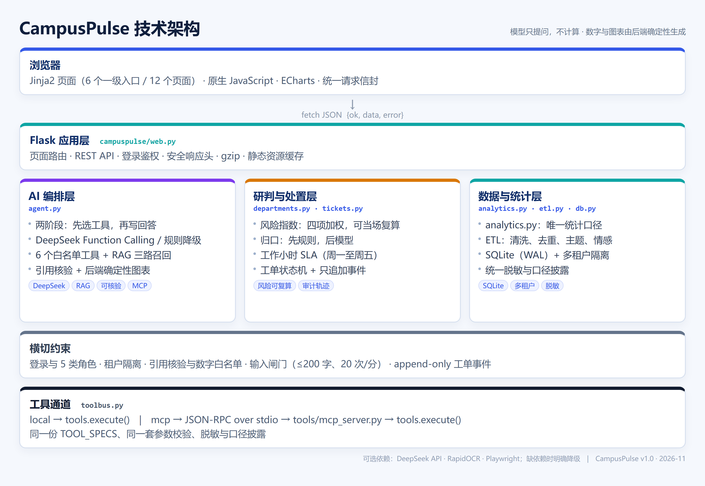

# CampusPulse｜面向高校舆情研判与协同治理的可溯源 AI Web 平台

> **让校园公开舆情从“看见图表”走向“有据可查、归口清晰、按工时闭环”：**  
> **多急（可复算风险指数）→ 归谁（规则+模型双层归口）→ 多久办结（工作小时 SLA）→ 如何闭环（人工在环工单与只追加审计）**

CampusPulse 是第九届传智杯全国高校 AI Web 开发挑战赛参赛作品。平台在「广东东软学院舆情分析系统」历史采集数据与清洗规则沉淀之上，深度融合 **受控 Function Calling 智能体、本地三路混合 RAG 检索、后置引用与数值双核验、MCP 双通道工具总线以及多租户工单状态机**，构建了一套兼具 AI 原生交互体验与工程可解释性的校园数字治理 Web 应用。

> **说明**：本仓库是项目的**开发主仓库**，包含提交包全部内容（一键启动、在线推理与交互演示所需的源码与预设数据集），另外保留开发阶段的单元测试套件（`tests/`）、自动化巡检脚本（`tools/verify_*.py`）与演示数据库（`data/campuspulse.db`）。赛方交付包即为本仓库去掉 `tests/` 与巡检脚本后的子集。

---

## 1. 项目简介

### 1.1 场景痛点与破局思路

在高校宣传、学工与后勤的日常工作流中，工作人员每天面对散落在抖音、小红书及微信群截图中的海量评论，真正棘手的往往不是“缺少可视化大屏”，而是四个无法被传统 BI 工具直接回答的业务问题：

- **轻重缓急如何量化？** 突发负面讨论是否达到需要当日介入的阈值？
- **责任主体如何界定？** 跨主题诉求应当分派给后勤、饮食、教务还是招生部门？
- **响应时限如何考核？** 周五傍晚发生的工单，如何在剔除周末非工作时间后客观计算超期率？
- **分析结论凭什么采信？** 大模型给出的與情摘要是否存在数值编造或张冠李戴？

CampusPulse 将传统“看板式舆情监测”向后推进至**“可核验分析 + 协同处置闭环”**：所有统计指标带分母溯源、风险指数支持四维现场拆解、模型回答强制经过原文锚点与数值白名单双重校验、工单流转严格绑定工作日工时日历（Working-Hour SLA）与不可篡改审计轨迹。

### 1.2 核心功能矩阵

| 模块 | 核心能力与工程特性 |
|---|---|
| **舆情总览驾驶舱** | 多数据集动态切换、情感结构分布、双平台声量对比、高风险主题预警、带分母口径的 AI 驾驶舱综述 |
| **多维数据洞察中心** | 八大校园业务主题热度、情感极性拆解、自适应粒度（日/周/月）时间趋势、正负面分面词云、评论长度与互动画像 |
| **热点与原文证据库** | 多条件组合筛选、脱敏原文检索、`[CMT-xxxxxxxx]` 证据锚点一键回跳定位、筛选状态跨页面 URL 保持 |
| **多模态数据与报告** | 批量 JSON 预览式导入、**群聊/社媒截图本地 OCR 智能解析入库**、Playwright 实时采集、带事实白名单约束的 AI 报告生成与导出 |
| **风险研判与工单闭环** | 四维加权风险指数（量级/负面率/增速/互动）、部门归口智能推荐、区间研判快照、十动作工单状态机与工作小时 SLA 计时 |
| **可溯源 AI 舆情助手** | SSE 实时流式思考可视化、6 大受控工具自主编排、**“对话即筛选”跨视图联动**、后端确定性图表渲染、引用与数值防幻觉核验 |
| **多租户与细粒度权限** | 管理员 / 分析员 / 处置员 / 只读 / 部门专席 5 类 RBAC 角色，数据库底层 `TenantConn` 强制租户隔离 |
| **MCP 双通道工具总线** | 同一套 `TOOL_SPECS` 既支持进程内零开销直调（`local`），也支持通过标准 `JSON-RPC 2.0 over stdio` 暴露为独立 MCP 服务端（`mcp`） |

### 1.3 六大核心技术亮点

1. **计算与生成解耦的受控 Agent 架构**：大模型负责意图理解、工具参数规划与自然语言总结；统计聚合、分母口径与 ECharts 图表配置由后端 `analytics.py` 与 `charts.py` 确定性生成。
2. **零 GPU 依赖的本地三路混合 RAG**：结合 jieba 词项 BM25、校园领域同义词扩展与 1024 维 CRC32 字符 2/3-gram TF-IDF，配合查询净化、未登录词二元切分、RRF/加权双算子与受限重排；校园标注集达到 `P@5=0.817`、`MRR=0.958`。
3. **引用锚点与派生数值双重核验**：`valid / invalid / unknown` 三态引用分类、一次受控重写、`strip_refs` 无损剥离与 ±1% 数值白名单共同构成 Veracity Engine。
4. **“对话即筛选”的生成式 UI 联动**：`_pick_richest_meta` 提取最具体的主题、平台、情感和时间上下文，`_carry_to_views` 生成带状态参数的跨视图跳转链接。
5. **契合高校作息的工作小时 SLA 引擎**：周一至周五 `09:00–12:00`、`14:00–18:00` 累计工作小时，SQLite 触发器保护 append-only 审计日志。
6. **全链路可观测降级与边缘可用性**：DeepSeek、RapidOCR、Playwright、MCP 均有明确状态码和切换路径；前端采用 Zero-Build 原生 ESM、视口懒加载、`NEG_DECAL` 纹理双编码与 WAI-ARIA 实时播报。

### 1.4 官方评审维度映射

| 评分维度 | 权重 | 评审可核验实现 |
|---|---:|---|
| AI 技术深度 | 35% | `agent.py` 两阶段编排、`rag.py` 三路 RAG、`vision.py` 多模态 OCR、`guard.py` + `veracity.py` 安全核验、`toolbus.py` MCP |
| 创新性 | 25% | 选题创新（高校治理）、技术方案创新（受控 Agent + RAG）、交互模式创新（对话即筛选） |
| 前端工程质量 | 10% | `core.js` 共享运行时、CPError、IntersectionObserver 懒加载、打印导出与无障碍 |
| 实用性 | 10% | 场景真实性与解决方案有效性：八大校园主题、四维风险指数、部门归口、工作小时 SLA、四预设数据集 |
| 用户体验 | 10% | UI 设计与视觉表现、前端交互体验、AI 交互体验：SSE 流式输出、TTFT 回显、工具步骤耗时、错误边界、Focus Trap、Live Region |
| 社会价值与商业潜力 | 10% | 社会价值与商业潜力：数据脱敏、议题级工单、Responsible AI、私有化交付与多租户演进 |

---

## 2. 技术架构



> 三条主线：AI 编排、研判处置、数据统计。模型只通过 6 个白名单受控工具取值；本地通道与 MCP 通道共用同一份 `TOOL_SPECS` 和同一套参数校验、脱敏与口径披露。

### 2.1 分层职责

| 层 | 关键文件 | 职责 |
|---|---|---|
| 表现层 | `campuspulse/templates/*.html`、`static/cp/*.js`、`static/cp/app.css` | 页面结构、交互、图表渲染、主题与无障碍 |
| 应用层 | `campuspulse/web.py` | 路由、REST 信封、鉴权、静态资源、安全头 |
| AI 编排 | `campuspulse/agent.py` | 两阶段调用：先选工具，再基于工具结果写回答 |
| 工具层 | `campuspulse/tools.py`、`toolbus.py`、`tools/mcp_server.py` | 6 个白名单工具、JSON Schema 校验、本地/MCP 双通道 |
| 检索层 | `campuspulse/rag.py` | BM25、同义扩展、字符 n-gram 向量、RRF、引用锚点 |
| 可核验性 | `campuspulse/veracity.py`、`guard.py` | 引用与数字校验、输入侧注入/越权拦截 |
| 统计层 | `campuspulse/analytics.py` | 唯一统计口径：筛选、分母、比率、时间序列 |
| 数据层 | `campuspulse/db.py`、`etl.py`、`taxonomy.py`、`legacy/data_processor.py` | SQLite、清洗、主题词典、情感规则、历史口径复用 |
| 研判处置 | `campuspulse/departments.py`、`tickets.py`、`monthly.py` | 风险指数、归口建议、区间研判、工单状态机 |

## 2.2 架构设计哲学

- **单一事实来源（Single Source of Truth）**：`analytics.py` 是全站唯一的统计口径出口，驾驶舱图表、AI 报告与 Agent 工具共享同一套过滤与分母计算逻辑，确保任意入口看到的数字绝对一致。
- **最小权限工具沙箱**：大模型与数据库完全隔离，仅能通过通过 JSON Schema 严格校验的 6 个只读分析工具获取结构化摘要，杜绝任意 SQL 注入或越权指令执行。
- **人工在环的议题治理边界**：系统聚焦于公共服务改进与响应效率提升，所有评论证据均经过正则脱敏处理；风险研判仅输出量化依据与归口建议，工单创建与复核结案必须由具备权限的责任人确认。

---

## 3. 目录结构

```text
CampusPulse/                      # 仓库根目录
├── README.md                     # 本文件
├── start.bat                     # Windows 一键启动（登录 + 工单演示配置）
├── run.py                        # 开发/演示启动入口（端口顺延、预热、可选自动开浏览器）
├── wsgi.py                       # 生产 WSGI 入口（gunicorn / waitress）
├── requirements.txt              # 全部依赖（核心 + OCR / MCP / Playwright）
├── requirements-ext.txt          # 扩展依赖明细，由 requirements.txt 自动引入
├── .env.example                  # 环境变量模板（复制为 .env）
├── Dockerfile                    # 生产镜像
├── docker-compose.yml            # 一键容器编排
├── .dockerignore                 # 镜像构建裁剪
├── docs/
│   ├── 技术文档.md               # 技术文档源文件
│   ├── 技术文档.pdf              # 提交用 PDF（≤30 页）
│   └── 技术架构图.png            # README 与答辩用架构图
├── datasets/                     # 全部预设数据集，按年份/来源分类
│   ├── 2022-2026/                # ds_hist_all：抖音 + 小红书合并
│   ├── 2023/                     # ds_2023_all / ds_2023_main：首批与第二批样本
│   └── 2020-2026-generated/      # ds_2020_2026：按真实样本特征生成
├── legacy/
│   └── data_processor.py         # 原系统清洗/统计规则，ETL 复用其历史口径
├── campuspulse/                  # 后端 Python 包
│   ├── web.py                    # Flask 应用、页面与 REST API
│   ├── agent.py                  # AI Agent 编排
│   ├── tools.py                  # 6 个受控工具
│   ├── rag.py                    # RAG 混合检索
│   ├── veracity.py               # 引用与数字核验
│   ├── guard.py                  # 输入侧安全防护
│   ├── analytics.py              # 统计口径
│   ├── etl.py                    # 清洗入库
│   ├── taxonomy.py               # 主题词典与归因
│   ├── departments.py            # 风险指数与归口
│   ├── tickets.py                # 处置工单状态机
│   ├── monthly.py                # 区间研判
│   ├── tenancy.py                # 角色、权限、会话、租户
│   ├── db.py / migrations.py     # SQLite 访问与迁移
│   ├── crawl.py / intake.py      # 实时采集 / 文件与截图导入会话
│   ├── vision.py                 # 截图 OCR
│   ├── reports.py / charts.py    # AI 报告 / 确定性图表
│   ├── toolbus.py                # 本地 / MCP 工具通道
│   ├── warmup.py                 # 启动预热
│   └── templates/                # 12 个页面模板
├── static/
│   ├── cp/                       # 前端运行时、页面脚本、样式
│   └── vendor/                   # ECharts 与词云插件（本地文件，不依赖 CDN）
├── tools/                        # 运维脚本与开发期巡检（非启动必需）
│   ├── mcp_server.py             # MCP stdio 服务端
│   ├── seed_demo_tickets.py      # 生成演示角色与工单
│   ├── make_dept_accounts.py     # 生成部门账号
│   └── verify_*.py               # UI / 安全 / 隔离 / 工单 / 语音等逐项巡检
└── tests/                        # 单元与验收测试（仅开发主仓库保留）
    ├── test_s0.py ~ test_s3.py   # 分期功能测试
    ├── acceptance.py             # 全量验收（写入演示库，跑完需清理）
    └── legacy_check.py           # 新旧清洗口径一致性对照
```

> 根目录只保留评审、启动与构建必须直接找到的标准文件（README、一键启动、入口脚本、依赖清单、Docker 配置），数据、源码、文档、静态资源和运维脚本都归入对应子目录。

> `data/campuspulse.db` 是随仓库提供的**演示数据库**（含预设数据集、演示账号与工单），克隆后直接启动即可看到完整数据。该目录下的会话密钥（`data/.session_key`）、上传目录、日志与备份不入库：换机器启动会重新生成会话密钥，用 `tools/seed_demo_tickets.py` 可重建演示工单。`.env` 同样不入库，只提供 `.env.example` 模板。

---

## 4. 环境要求与配置

### 4.1 运行环境

| 项 | 要求 |
|---|---|
| Python | 3.10+（推荐 3.11 / 3.12） |
| 操作系统 | Windows / Linux / macOS |
| 浏览器 | Chrome / Edge（实时采集可选，Playwright 可复用本机浏览器） |
| 内存 | 本地演示 2GB 足够；无需 GPU |
| 网络 | 首次安装依赖需要；运行与演示可离线（DeepSeek 为可选在线能力） |

> 请使用稳定版 Python。Python 3.15 预览版自带的 pip 在当前 Windows 环境下可能因 `msgpack` / `frozendict` 不兼容而无法安装依赖；`start.bat` 会优先选择 Python 3.11，并在检测到 3.15 环境时提示重建。

### 4.2 依赖清单

`requirements.txt` 默认安装**全部功能依赖**（核心依赖 + OCR + MCP + 实时采集）。核心依赖如下：

```text
flask>=2.0
flask-cors>=3.0
pandas>=1.3
numpy>=1.20
openpyxl>=3.0
jieba>=0.42
requests>=2.25
```

`requirements.txt` 末尾通过 `-r requirements-ext.txt` 自动引入扩展依赖，无需再单独安装：

| 扩展 | 依赖 | 影响的接口 |
|---|---|---|
| 截图评论 OCR | `rapidocr_onnxruntime`、`pillow` | `/api/vision/*` |
| MCP 官方 SDK 交叉验证 | `mcp>=1.9,<2` | 仅验证脚本；MCP 服务端本身用标准库 |
| 实时采集 | `playwright` | `/api/crawl/*` |

实时采集还需要浏览器内核，`start.bat` 会在依赖安装后自动执行 `playwright install chromium`；手动安装命令见 5.2。

生产部署再按平台安装一个 WSGI 服务器：

```bash
pip install gunicorn     # Linux
pip install waitress     # Windows
```

### 4.3 环境变量模板

复制模板后填写：

```bash
# Windows
copy .env.example .env
# macOS / Linux
cp .env.example .env
```

| 变量 | 必填 | 默认 | 说明 |
|---|---|---|---|
| `DEEPSEEK_API_KEY` | 否 | 空 | 不填则切换为确定性规则路由，统计、图表与证据链保持完整 |
| `DEEPSEEK_BASE_URL` | 否 | `https://api.deepseek.com` | 兼容其他 OpenAI 风格网关 |
| `DEEPSEEK_MODEL` | 否 | `deepseek-chat` | 模型名 |
| `PORT` | 否 | `8000` | 监听端口；被占用时 `run.py` 自动顺延 |
| `CP_HOST` | 否 | `127.0.0.1` | 部署到容器/公网时设为 `0.0.0.0` |
| `CP_DB_PATH` | 否 | `data/campuspulse.db` | 指定 SQLite 路径（验收脚本常用副本） |
| `CP_AUTH` | 否 | `0` | `1` 开启登录与角色权限 |
| `CP_TICKETS` | 否 | 跟随 `CP_AUTH` | `1` 显示处置工单 |
| `CP_CITATION_GUARD` | 否 | `1` | 引用核验：`1` 硬阻断 / `0` 只记录 |
| `CP_TENANCY` | 否 | `1` | 多租户隔离 |
| `CP_CRAWL` | 否 | `1` | 实时采集入口开关 |
| `CP_VISION` | 否 | 自动 | 截图 OCR 入口开关 |
| `CP_TOOL_CHANNEL` | 否 | `local` | `local` 进程内直调 / `mcp` 走 MCP stdio |
| `CP_MONTHLY` | 否 | 跟随 `CP_AUTH` | 后台定期研判定时器 |
| `CP_WARMUP` | 否 | `1` | 启动预热（词典、检索索引、首次查询） |
| `AUTO_OPEN_BROWSER` | 否 | `0` | `1` 启动后自动打开浏览器（仅本机） |

> `.env` 已被运行包排除，提交前请确认不要把真实 Key 打进压缩包。

---

## 5. 安装与运行

### 5.1 Windows 一键启动（推荐演示）

双击 `start.bat`。脚本会：

1. 检查 `.venv`，不存在则创建；
2. 安装 `requirements.txt`；
3. 设置 `CP_AUTH=1 CP_TICKETS=1 AUTO_OPEN_BROWSER=1`；
4. 启动 `run.py`，浏览器自动打开。

首次启动会自动生成管理员账号，密码写入 `data/initial_admin.txt`。

### 5.2 手动启动

```bash
python -m venv .venv
# Windows
.venv\Scripts\pip install -r requirements.txt
# macOS / Linux
.venv/bin/pip install -r requirements.txt

# 实时采集需要浏览器内核（Windows）
.venv\Scripts\python.exe -m playwright install chromium
# macOS / Linux
.venv/bin/python -m playwright install chromium

# 配置 Key（可选）
copy .env.example .env

# 启动
.venv\Scripts\python.exe run.py
```

默认访问 <http://127.0.0.1:8000>。端口被占用时会自动顺延并在控制台提示。

**两种启动方式的区别：**

| 方式 | 页面入口 | 登录 | 适用场景 |
|---|---|---|---|
| `start.bat` | 6 个一级入口 / 12 个页面 | 是 | 答辩、角色权限与工单演示 |
| `python run.py` | 6 个一级入口 / 12 个页面（工单为只读列表） | 否 | 调试、快速查看数据 |

> `start.bat` 首次运行会自动创建 `.venv`、安装全部依赖（含 OCR / MCP / Playwright）并下载 Chromium 内核；之后启动直接复用。

### 5.3 生产部署（Docker）

```bash
# 全部功能镜像（约 1.2GB，含 OCR / MCP / Playwright Chromium）
docker build -t campuspulse:1.0 .

docker run -d --name campuspulse -p 8000:8000 \
  -e CP_AUTH=1 -v $(pwd)/data:/app/data campuspulse:1.0
```

或直接：

```bash
docker compose up -d --build
```

生产环境必须使用 **1 个 worker + 多线程**（`wsgi.py` 顶部说明了三个硬约束：SQLite 写锁、MCP 子进程单例、进程内缓存）。

### 5.4 首次启动会发生什么

1. 创建 `data/`、`data/uploads/`、`data/logs/`；
2. 初始化/迁移 SQLite 表结构；
3. 从 `datasets/2022-2026/`、`datasets/2023/` 与 `datasets/2020-2026-generated/` 导入内置数据集（数秒到十几秒）；
4. 生成管理员账号并写入 `data/initial_admin.txt`；
5. 可选：后台预热词典、检索索引与首次统计查询。

之后启动直接读 `data/campuspulse.db`。

### 5.5 账号与角色

| 角色 | 能做什么 |
|---|---|
| 管理员 `admin` | 全部权限：分析、导入、报告、建单、分派、复核归档、用户管理 |
| 分析员 `analyst` | 看分析、导数据、生成报告、确认建单 |
| 处置员 `handler` | 看工单证据、开始处理、提交复核 |
| 只读 `viewer` | 只看分析页面 |
| 部门账号 `dept` | 只看归口本部门的研判与工单，提交复核，不能建单/分派/归档 |

管理员账号首次启动自动生成。需要演示多角色时，可运行：

```bash
# 生成分析员/处置员/只读账号与示例工单
.venv\Scripts\python.exe tools\seed_demo_tickets.py
# 生成后勤/饮食/招生三个部门账号
.venv\Scripts\python.exe tools\make_dept_accounts.py
```

生成结果分别写入 `data/demo_accounts.txt` 与 `data/dept_accounts.txt`。

---

## 6. 数据集与清洗口径说明

运行包内置 4 个预设数据集，首次启动时自动执行 ETL 清洗入库：

| dataset_id | 展示名称 | 数据物理路径 | 数据性质 | 原始记录数 | 有效评论数 | 覆盖时间与口径说明 |
|---|---|---|---|---:|---:|---|
| `ds_hist_all` | 2022–2026 | `datasets/2022-2026/*.json` | 真实平台采集 | 23,724 | 1,960 | 截取 2022-01 至 2026-07 窗口（全量历史批次共 25,699 条，旧版规则基线为 1,823 条；升级八大主题词典并剔除 2022 年前 1,975 条早期记录后，窗口内有效样本为 1,960 条） |
| `ds_2023_all` | 2023（合并） | `datasets/2023/`（4 个文件） | 真实采集+扩充样本 | 2,830 | 2,567 | 2023 年秋招与开学季密集样本合并，去重与清洗后保留 2,567 条 |
| `ds_2023_main` | 2023 | `datasets/2023/douyin_comments.json`、`xhs_comments.json` | 首批密集样本 | 1,830 | 1,830（100.00%） | 2023 年首批基准样本（抖音 941 条 + 小红书 889 条），连续覆盖招生与迎新节点 |
| `ds_2020_2026` | 2020–2026 | `datasets/2020-2026-generated/*.json` | 分布保持合成语料 | 7,386 | 1,979 | 依据历史真实样本的时间节律、长度与互动分布重采样生成（固定随机种子可复现），专门用于补齐「实习就业」等长尾主题的八维全覆盖演示与压力测试 |

> `ds_hist_all` 的口径演进为：全量历史批次共 25,699 条原始记录（旧版 `legacy` 规则基线为 1,823 条有效评论）；升级八大校园主题词典与清洗管线后，截取 2022-01 至 2026-07 核心窗口，共 23,724 条原始记录，前置剔除 2022 年前早期记录 1,975 条，在新统计口径下召回 1,960 条高质量有效评论（有效率 8.26%）。`ds_2023_main` 经当前 ETL 清洗后为 1,830 / 1,830（100.00%）。所有占比指标均显式披露分母；主题归属采用多标签计数，主题计数总和高于有效评论总数属于预期统计特征。
---

## 7. AI Agent 与工具

### 7.1 两阶段编排

```text
用户问题
  → 输入侧四道闸：长度 / 频次 / 意图（注入、套提示词、越权取数）/ 展示脱敏
  → 第一阶段：模型只选工具、填参数
  → 后端执行工具：真实 SQL / 检索 / 统计
  → 第二阶段：模型只基于工具结果写 2–5 句回答
  → 引用核验：valid / invalid / unknown → 改写 / 剔除 / 标注
  → 图表与证据由后端 charts.py、analytics.py 生成
```

**交互体验**：Agent 通过 SSE 推送 `stage / plan / tool_start / tool_done / token / verdict / done` 事件，运行面板实时回显 TTFT、工具步骤与耗时；`_pick_richest_meta` + `_carry_to_views` 将最具体的主题、情感、平台、时间筛选编码为状态 URL，支持从问答卡片直接进入驾驶舱或洞察中心继续深钻。

### 7.2 六个受控工具

| 工具 | 回答什么问题 |
|---|---|
| `get_sentiment_stats` | 正面/中性/负面数量、占比与分母，可按平台拆分 |
| `get_topic_stats` | 8 类校园主题排行、负面原因、正面卖点 |
| `get_time_trend` | 按日/周/月的评论量与正负面时间序列 |
| `compare_platforms` | 抖音 vs 小红书的量级、情感、互动对比 |
| `search_comments` | 按关键词/条件精确检索评论证据 |
| `retrieve_context` | RAG 混合检索原文片段，返回可引用编号 |

### 7.3 可控性设计

- **最小权限工具沙箱**：模型仅能调用 6 个受控函数，参数先过 JSON Schema，再进入统计或检索执行；
- **计算与生成解耦**：数字、图表坐标、证据列表由后端产生，回答经过引用与数值双核验；
- **规则路由也可溯源**：未配置 DeepSeek 时，确定性统计回答会自动补入本轮 RAG 命中的前 3 个真实 `CMT-*` 锚点，演示环境同样保持“结论—原文—核验”闭环；
- **组合规则输入护栏**：NFKC、零宽字符剥离、动作词与对象词共现规则，拦截事件写入 `guard_events` 审计表；
- **可追溯引用**：`CMT-*` 锚点只来自本轮检索结果，`valid / invalid / unknown` 分类与一次受控重写均可审计；
- **透明降级矩阵**：DeepSeek、OCR、Playwright、MCP 通道均通过健康检查披露当前状态。

### 7.4 MCP 通道

默认 `CP_TOOL_CHANNEL=local`，进程内直调。设为 `mcp` 后，`toolbus.py` 会拉起常驻子进程 `tools/mcp_server.py`，通过 JSON-RPC over stdio 调用同一套 `tools.execute()`。

```bash
# 查看 MCP 工具清单
.venv\Scripts\python.exe tools\mcp_server.py --list
```

MCP 与本地通道的参数校验、脱敏、口径披露完全一致；MCP 通道异常时切换本地直调，并在健康检查里记录 fallback 状态。

---

## 8. 验收与自检

本仓库包含完整的验收与巡检脚本（`tests/` 与 `tools/verify_*.py`）。交付前可按以下顺序自检：

```bash
# 0) 全套自动化验收（会向演示库写入历史报告，跑完用 tools/clean_devdata.py --apply 清回）
python tests/acceptance.py

# 1) 语法检查
python -m compileall campuspulse legacy run.py wsgi.py tools

# 2) 启动服务（另开终端）
python run.py

# 3) 健康检查
curl http://127.0.0.1:8000/api/health

# 4) 关键页面（浏览器打开）
#    /                 舆情总览
#    /insights         数据洞察中心
#    /insights/topics  主题热度
#    /insights/sentiment 情感分析
#    /insights/timeline  时间趋势
#    /evidence         热点与证据
#    /data             数据集与质量
#    /data/collect     数据采集与导入
#    /data/reports     AI 分析报告
#    /departments      风险研判
#    /agent            AI 舆情助手
```

`/api/health` 会返回版本、数据集数量、LLM 是否启用、当前引擎（`deepseek` / `rules`）、认证模式、租户泄漏计数、工单开关、引用核验状态、工具通道与 OCR/采集引擎状态，可用来快速判断环境是否完整。

**手工验收建议：**

1. 首页能加载数据集概况与图表；
2. 切换数据集后，洞察页分母与有效率同步变化；
3. Agent 提问“食堂最近负面多吗”，能看到工具调用步骤、真实图表与证据编号；
4. 证据页点击编号能回跳原文；
5. `start.bat` 启动后，管理员能建单、分派、提交复核、归档，时间线有完整事件；
6. 未配置 Key 时，页面明确显示规则引擎而不是伪装成 AI。

---

## 9. 团队信息（已按 3 人赛制标准重构）

| 角色 | 姓名 | 核心职责与模块分工 |
|---|---|---|
| **队长 / AI 架构与后端工程** | 刘根源 | 负责系统总体架构、Flask 应用层（`web.py`）、三阶段受控 Agent 编排（`agent.py`）、本地/MCP 双通道工具总线（`toolbus.py` / `mcp_server.py`）、引用与数值核验引擎（`veracity.py` / `guard.py`）及容器化部署 |
| **核心成员 / 数据工程与检索算法** | 邓健翔 | 负责多源数据清洗管线（`etl.py`）、八大校园主题词典与情感规则（`taxonomy.py`）、三路混合 RAG 检索引擎（`rag.py`）、四维可复算风险指数与多租户工单 SLA 模型（`departments.py` / `tickets.py`） |
| **核心成员 / 前端工程与交互设计** | 黄文涛 | 负责前端共享运行时（`core.js`）、12 个业务视图与 ECharts 确定性可视化渲染、SSE 流式思考状态呈现、深浅双主题与 WAI-ARIA 无障碍适配、全链路验收测试与技术文档撰写 |
| **指导教师** | 庞薇、宋雨婷  | 负责高校舆情治理业务场景建模、数据合规边界把关与系统架构指导 |

**参赛信息**：第九届传智杯全国高校 AI Web 开发挑战赛（B 组 · 团队赛）

---

## 10. 常见问题

**Q1：没有 DeepSeek Key 能运行吗？**
能。系统会切换到确定性规则路由，统计、图表与证据链保持完整；界面会明确标注当前引擎类型。

**Q2：首次启动很慢 / 页面暂时没有数据？**
首次启动要把内置数据集清洗入库（数秒到十几秒），控制台会打印导入进度。完成后刷新即可。之后启动直接读 SQLite。

**Q3：端口 8000 被占用？**
`run.py` 会自动顺延到下一个可用端口并在控制台提示；部署到容器时设置 `CP_HOST=0.0.0.0`，端口被占用会直接报错而不是偷偷换端口。

**Q4：截图导入提示“未检测到 OCR 引擎”？**
默认安装已包含 `rapidocr_onnxruntime`。若仍提示，通常是使用了精简安装：执行 `.venv\Scripts\pip install -r requirements.txt` 后重启即可。

**Q5：实时采集没有数据？**
实时采集需要 `playwright`、Chromium 内核和平台登录态。`start.bat` 会自动安装依赖与浏览器内核；未登录时平台会拦截搜索/评论接口，系统会明确提示 `need_login`，而不是返回空结果让你误以为“今天没人讨论”。

**Q6：为什么工单时限是“工作小时”？**
按自然小时计算会在周末产生假超期。SLA 只累计工作日 09:00–12:00、14:00–18:00，节假日默认空，不猜测。

**Q7：数据会不会上传到第三方？**
默认不。评论、截图、数据库都在本机；只有调用 DeepSeek 时会把必要的统计结果/文本片段发往模型 API。截图 OCR 优先本地推理，数据不出校。

**Q8：双击 `start.bat` 报 `pip._vendor.msgpack` / `frozendict` 错误？**
这是 Python 3.15 预览版自带 pip 的兼容问题，不是项目依赖问题。请安装稳定的 Python 3.11（推荐）或 3.12，然后删除项目内的 `.venv` 再双击；新版 `start.bat` 会自动优先使用 3.11。

---

## 11. 工程架构权衡与演进路径

- **领域规则 + 按需推理**：八大校园主题词典负责秒级全量标注，大模型聚焦复杂长尾问答与归口解释，形成零 GPU 场景下的吞吐与语义协同。
- **字符 n-gram + 可插拔稠密向量**：本地混合检索提供确定性召回，`EMBEDDING_HOOK` 为校内向量模型接入保留稳定扩展点。
- **平台适配层**：实时采集通过 Playwright 与登录态状态机承接页面结构变化，数据导入、截图 OCR 和本地 RAG 保持独立运行。
- **业务配置可演进**：部门、责任人和 SLA 以配置表驱动，接入学校实际组织架构即可完成私有化落地。
- **范围透明**：统计结论严格绑定当前数据集、时间窗口与筛选条件，页面和技术文档同步披露分母与数据版本。

---

**版本**：v1.1（2026-11）
**技术栈**：Python 3 / Flask / SQLite / 原生 JavaScript / ECharts / DeepSeek Function Calling / 本地 RAG
